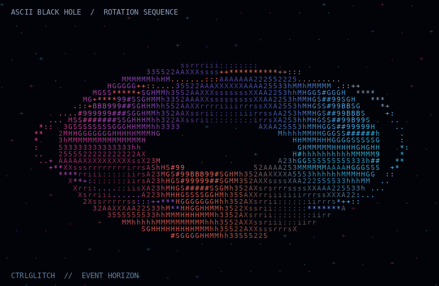

<div align="center">



# KUSHAGRA <span style="color:#FF4D9D">GARG</span>

### CSE STUDENT · BACKEND ENGINEERING · SECURITY · AI/ML

**Building systems. Breaking assumptions. Understanding what's underneath.**

[](https://github.com/ctrlglitch-arch)
[](https://www.linkedin.com/in/kushagra-garg24/)
[](https://leetcode.com/u/Ctrl-Gglitch/)


</div>

---

## `01 / DEVELOPER STATUS`

<table>
<tr>
<td>

```yaml
identity: Kushagra Garg
role: CSE Student / Developer
currently_building:
  - Backend systems
  - Developer tools
exploring:
  - Cybersecurity
  - AI / ML
  - System design
philosophy: >
  Understand deeply.
  Build carefully.
  Ship consistently.
```

</td>
<td width="42%" valign="middle">

### Current coordinates

- 🔷 **Backend:** APIs, authentication, databases
- 🟣 **Security:** secure coding and vulnerability analysis
- 🟢 **AI / Data:** Python and applied experiments
- 🟠 **Foundations:** DSA, operating systems, Git

</td>
</tr>
</table>

---

## `02 / CONTRIBUTION SIGNAL`

<div align="center">

### Every commit leaves a trace.


</div>

> Contribution data comes from GitHub. Third-party cards may occasionally be unavailable. Language statistics reflect detected repository code, not a complete measure of skill.

---

## `03 / LANGUAGES & TOOLKIT`

<div align="center">

### Languages


### Backend · Data · Infrastructure


### AI · Computer Vision · Prototyping


</div>

*This is a working toolkit, not a claim of equal proficiency in every technology. Remove any icon that doesn't represent experience you can discuss.*

---

## `04 / SELECTED BUILDS`

<table>
<tr>
<td width="50%" valign="top">

### 🛡️ CICR Inventory

Backend hardening work focused on admin access controls, authentication flows, and testing.

`Node.js` `TypeScript` `Supabase` `Jest`

[Repository →](https://github.com/Sun-fire-nikka/cicr-inventory-1.0)

</td>
<td width="50%" valign="top">

### 🧠 LazyDoc

Python + LLM + Streamlit document analysis and summarization project.

`Python` `Groq` `Streamlit`

[Browse repositories →](https://github.com/ctrlglitch-arch?tab=repositories)

</td>
</tr>
<tr>
<td width="50%" valign="top">

### 👁️ NeelNETRA

Computer-vision project exploring real-world visual detection and analysis.

`Python` `Computer Vision` `Deep Learning`

[Browse repositories →](https://github.com/ctrlglitch-arch?tab=repositories)

</td>
<td width="50%" valign="top">

### 🔐 Kosi V0.1

A developing security-focused vulnerability and risk-analysis model.

`Python` `Security` `ML`

[Browse repositories →](https://github.com/ctrlglitch-arch?tab=repositories)

</td>
</tr>
</table>

---

## `05 / ENGINEERING LOG`

<table>
<tr>
<td width="50%" valign="top">

### In progress

- Build complete, documented projects
- Strengthen API and database design
- Improve testing and secure coding
- Practice DSA and core CS fundamentals

</td>
<td width="50%" valign="top">

### Next orbit

- Contribute to open source
- Learn from real codebases
- Ship a useful developer tool
- Explore deeper systems and security

</td>
</tr>
</table>

---

## `06 / THE PRINCIPLE`

<div align="center">

> I don't just want to use technology.  
> I want to understand how it works under the hood.

**— CTRLGLITCH**

`SMALL STEPS` &nbsp; · &nbsp; `BIG SYSTEMS` &nbsp; · &nbsp; `ALWAYS EVOLVING`

</div>

---

<div align="center">

[GitHub](https://github.com/ctrlglitch-arch) ·
[LinkedIn](https://www.linkedin.com/in/kushagra-garg24/) ·
[LeetCode](https://leetcode.com/u/Ctrl-Gglitch/)

<sub>Built with curiosity, terminal text, and a slightly unreasonable love of space.</sub>

</div>
